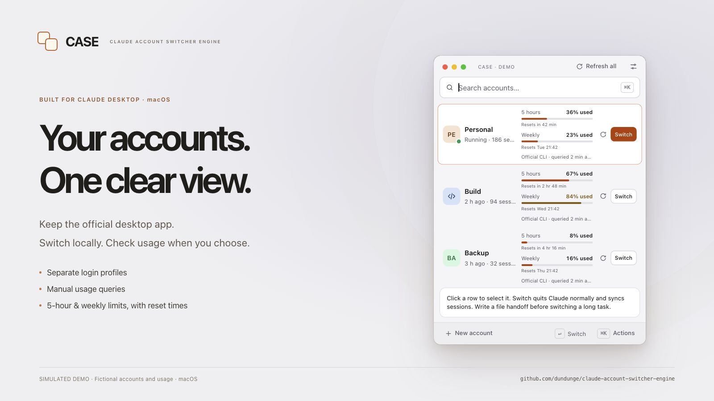

# CASE independent edition

[中文](README.md)

Based on [CASE by Patryk Starostka](https://github.com/pstarostka/claude-account-switcher-engine),
version 4.1.0. The original MIT copyright is retained; see [NOTICE.md](NOTICE.md).
This repository is maintained independently. Update checks, source and release links
use `dundunge/claude-account-switcher-engine` exclusively; upstream is never merged automatically.

CASE is for people who prefer the **official Claude Desktop** while using multiple accounts.
It manages local account switching, session index sync and manual quota queries.
**It does not use a reverse proxy or model API relay.**

**Currently adapted and verified only with Claude Pro.** The maintainer does not have a Max subscription
account, so Max has not been adapted or verified.



*Simulated demo with fictional accounts and usage, using the project's actual UI.*
See the [screenshot gallery](docs/SCREENSHOTS.md) and [local browser demo](docs/demo/README.md).

## Features

- Separate official Claude Desktop login directories.
- A compact home account list: clicking a row only selects it. Each row has a fixed Switch button
  and a refresh icon for that account. Refresh all queries accounts sequentially and continues after a failure.
  The account context menu, Actions menu and explicit keyboard switching shortcuts remain available.
- Chinese / English selection in Settings → General, applied to both windows and native menus,
  remembered after restart. Account names and other user data are never translated.
- Claude-style compact rows show five-hour and weekly (all models) **used** percentages, reset notices and
  thin progress bars, with observation time and source. Hover for the full reset date, time zone and remaining
  quota. Relative notices are marked as estimates; missing reset times are explicitly unavailable.
- Settings → Usage queries holds per-account details, authorization, reauthorization, Open independent CLI
  and error details. Authorization runs official Claude Code login in Terminal and opens the official login
  link in an account-isolated Electron window, without reusing system-browser or Desktop login state.
  Each account has its own CLI configuration directory. Account and organization UUIDs must match the Desktop profile.
  CASE does not read cookies, tokens or Keychain credentials; the official CLI manages its own isolated login.
- Open independent CLI reuses that account's existing login; reauthorization is a separate action.
  Running `claude` in an ordinary Terminal still uses the default CLI configuration.
- Per-account refresh, Refresh all and the query action in Settings run official `/usage`, including for closed accounts. **Only on click:** no scheduled
  queries or automatic retries, model messages or account switching. Failed queries return null; status polling
  cannot refill old percentages.
- With no independent CLI binding, Read panel observes the open account's Claude panel. This path requires
  macOS Accessibility permission and may briefly open and close the Usage popover.
  Reset notices retain their original wording. Estimated resets stay anchored to the original observation,
  rather than moving forward on repaint; they do not imply a server refresh timestamp.
- Read saved records reads Claude's `plan-usage-history.json` and CASE's last panel observation. These can be old.
  This is an explicit history read. Original timestamps are retained; missing limits are unknown.
- An offline local index sync engine, preserving parent and child relationships. Claude retains ownership of transcripts.
- Switching shows waiting, validation, sync and launch stages; an interruption keeps its snapshot identifier for recovery.

No Claude bundle modification, transcript upload, cloud chat migration or quota reset.
Local index sharing cannot transfer another account's model context cache. Use local handoff files for long tasks.

See [docs/MANUAL-USAGE.md](docs/MANUAL-USAGE.md) for manual queries and
[docs/NATIVE-USAGE.md](docs/NATIVE-USAGE.md) for panel fallback limitations. CodexBar is not required.

## No reverse proxy: official clients and login flows

CASE does not provide or inject a reverse proxy, model API gateway or request relay, and does not rewrite
Claude API endpoints. It does not extract or copy Desktop cookies, tokens or Keychain credentials.
Desktop remains the official Claude application. The unmodified official Claude Code CLI owns usage login,
credential storage and refresh, and `/usage`. CASE reads non-credential identity metadata, official login
status and quota output.

Electron only supplies an isolated official login window for each account. It is a Chromium desktop framework;
this implementation does not spoof fingerprints, assign proxies, inject page scripts or intercept authorization
codes. Users confirm OAuth and workspace trust themselves. The official CLI handles its local OAuth callback
and credential exchange.

This describes CASE's own architecture. Official clients may still use the user's existing system proxy or
proxy environment variables. CASE does not change, reload or restart Clash/Mihomo.

## Why account switching and quota queries are separate

| Path | Login and data scope | Trigger and effect |
| --- | --- | --- |
| Desktop switch | Official Desktop login in a separate `--user-data-dir` per account | Explicit Switch action; normal Claude exit, local index validation and sync, then target-account launch |
| Usage authorization | Separate CLI configuration, empty workspace and Electron login directory per account | An explicit Settings action; account/org must match the target Desktop profile |
| Quota query | Official CLI `/usage` in the bound account scope | Manual refresh of one or all accounts; no Desktop switch, client exit or automatic login |

1. **The login states differ.** A signed-in Desktop profile does not authorize the isolated CLI. Each account
   needs its own official usage authorization and initial setup. CASE does not copy Desktop credentials or
   change the default CLI login to bypass that separation.
2. **Queries should not interrupt work.** Closed accounts can be queried without leaving the active Desktop account.
3. **A query failure should stay a query failure.** Network or endpoint errors clear the current value and report
   a reason. Retry, opening the account's CLI, reauthorization and switching are separate actions. An authorized
   account can open its CLI for diagnosis without logging in again.
4. **Identity and freshness need explicit checks.** Results are bound to the profile, account/org and authorization
   revision, checked before and after queries. Background capture also verifies official request-success evidence;
   fallback percentages after a failed request cannot count as a successful query. An official same-account snapshot
   under 60 seconds old retains its original observation time.

`usage_refresh` uses `success`, `auth_failed`, `unavailable`, `in_progress`, `failed` and `timeout`.
Every failed attempt returns `usage: null`; later status polling cannot restore an old percentage.
Only clicks request quota. Local state polling and time-label repainting do not.

## Verification status

Latest offline source verification on 2026-10-25 (America/Los_Angeles): **220 tests passed** — Python 120,
Rust unit 64 plus bridge 3, and Node 33. Formatting, Clippy and JavaScript syntax checks passed.
Grok checked 77 file hashes and reran 15 Node tests against the preceding audit package, reporting three issues.
The current source fixes the panel-lock status, background-activity parsing and batch counts for queries already
running in another window. These fixes await independent re-review; see the
[audit follow-up](docs/AUDIT-FOLLOWUP-20261025.md).

The preceding `103dd9f` version passed **214 tests** and was built and installed locally.
Manual queries in that installed app succeeded for three
independently authorized accounts, showing both used percentages and their reset times. Row selection,
single-account refresh, Refresh all, Settings management and opening an authorized independent CLI were checked.
No real Desktop switch was executed in that round; its event routing is covered by offline tests.
The audit fixes have not replaced that installed app. The browser demo and screenshots do not verify real accounts.

Implementer testing and independent review have separate scopes; official requests may still fail.
See [docs/GROK-AUDIT-20261025.md](docs/GROK-AUDIT-20261025.md) for the preceding scope and reproduction commands.
This update publishes source and documentation; it does not create a new GitHub Release.

## Build and update

The complete integration currently targets **macOS**. Windows source still receives Rust compilation checks;
local sync and official usage integration have not been completed there, and no Windows artifact is released.

From a Terminal in the repository, with Rust, Xcode Command Line Tools and Tauri CLI installed:

```zsh
cargo install tauri-cli --version '^2' --locked
cargo tauri build --bundles app --ci
```

The result is `target/release/bundle/macos/CASE.app`. Quit CASE normally before replacing
`~/Applications/CASE.app`; preserve all profile directories, `CASE/accounts.json` and `ClaudeSessionSync`.
The sync engine is installed separately. In-app updates only check our releases and open the instructions,
so an application replacement cannot silently omit a required engine migration.
The app is ad-hoc signed, not notarized; use the normal macOS security flow on first launch.

```zsh
cargo fmt --check
cargo clippy --all-targets -- -D warnings
cargo test
python3 -m unittest discover -s tests/python -q
node --test tests/*.test.cjs
```

## Local sync setup

See [docs/LOCAL-SYNC.md](docs/LOCAL-SYNC.md). The application fails closed before launching a different
profile if its `ClaudeSessionSync/CASE/hook.json` is missing or invalid.
`tools/migrate_cockpit_to_case.py` is only for an initial migration with an existing, reviewed Cockpit
sync configuration. It previews by default and refuses to overwrite existing CASE profiles or configuration.
There is no general first-run sync installer in this version. Already migrated users must not rerun it.

[MIT licence](LICENSE). This project is not affiliated with Anthropic.
