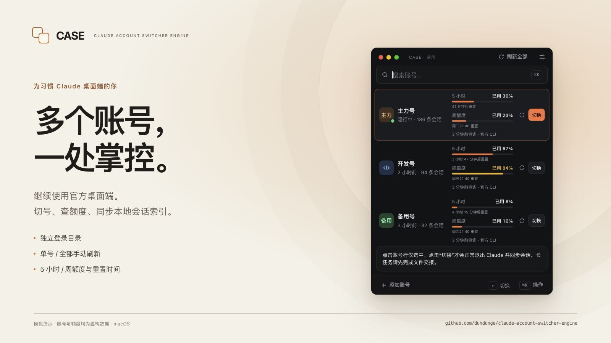
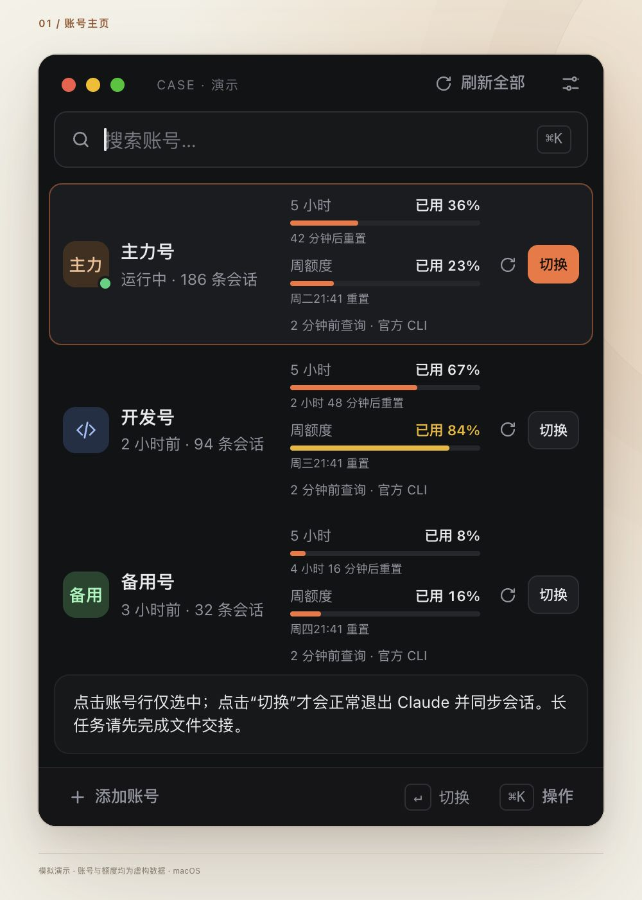
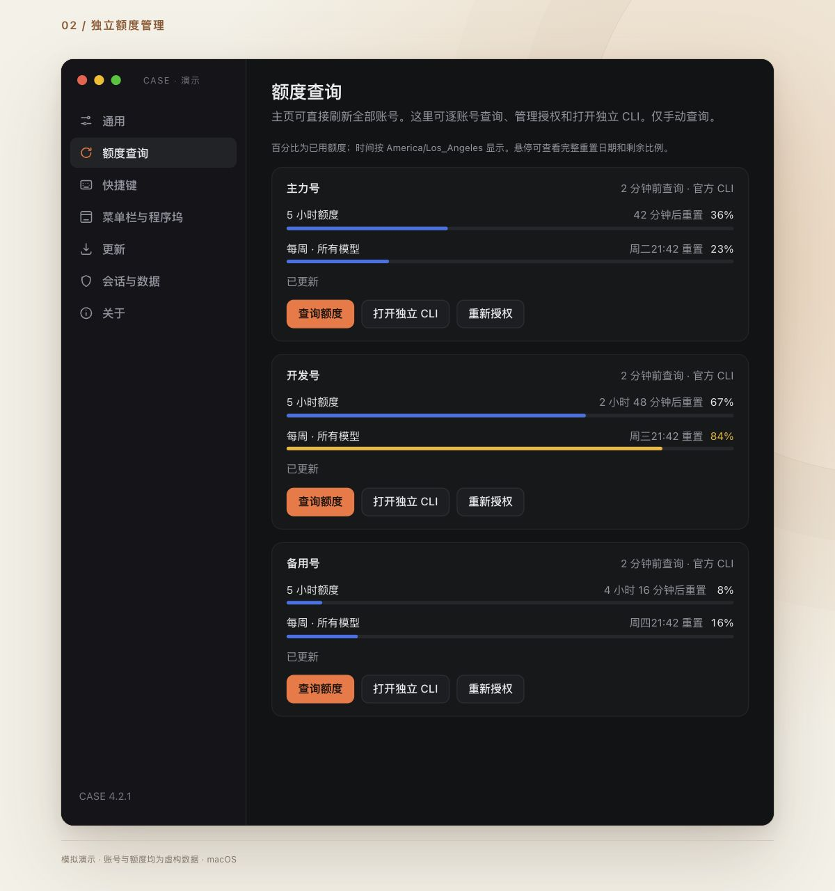
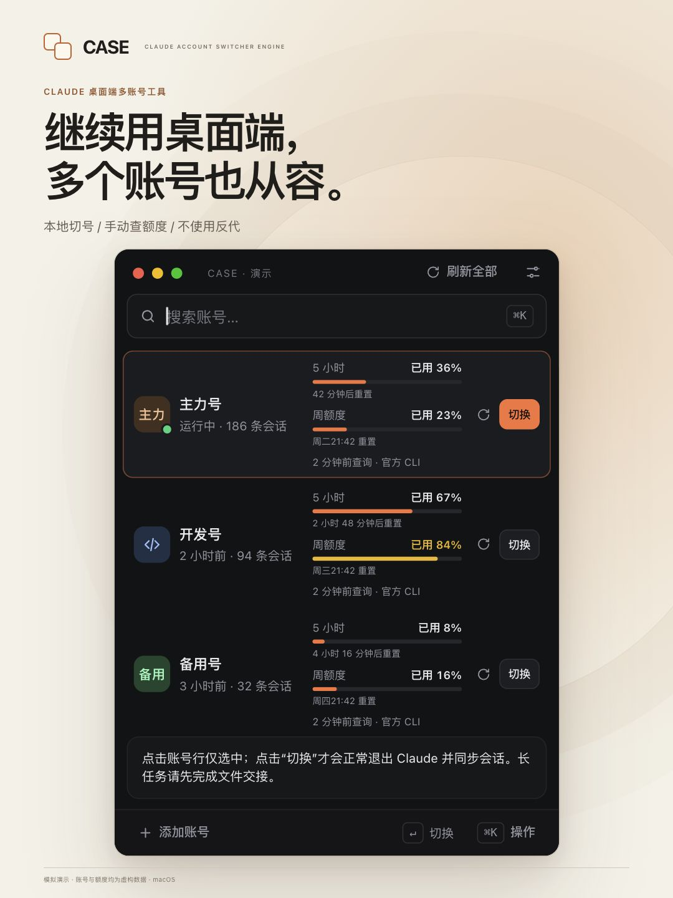
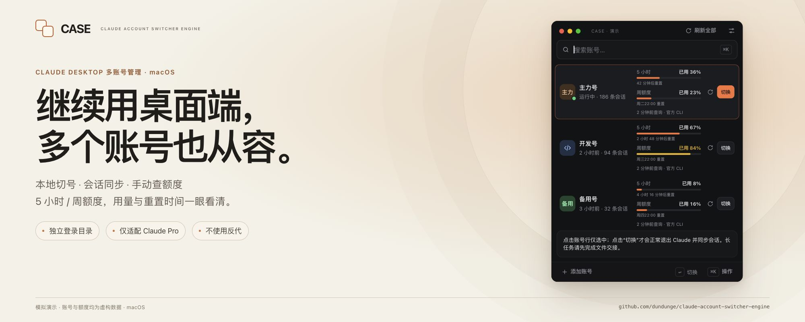

# 项目截图 / Screenshots

所有图片均来自本地模拟网页版，复用本项目实际的 HTML、JavaScript 和 CSS。
三个账号名称、会话数、额度和重置时间均为虚构数据，每张图片已标明“模拟演示”。
这些图片用于说明界面，不代表真实账号查询或服务可用性验证。

目前仅适配并验证 Claude Pro；维护者没有 Max 订阅号，Max 尚未适配和验证。

All images use the actual UI with fictional accounts and usage. They are labeled as simulated demos,
not real-account verification. Current adaptation and verification cover Claude Pro only, not Max.

## 选图

| 图片 | 尺寸 | 建议用途 |
| --- | --- | --- |
| [中文封面](media/case-overview-zh.jpg) | 1600 × 900 | GitHub README、帖子首图 |
| [账号主页](media/case-launcher-zh.jpg) | 1000 × 1400 | 展示三账号、单号刷新和明确的切换按钮 |
| [额度管理](media/case-usage-zh.jpg) | 1200 × 1280 | 展示独立授权、查询及各账号详细读数 |
| [English cover](media/case-overview-en.jpg) | 1600 × 900 | English README、英文介绍 |
| [竖版宣传图](media/case-social-portrait-zh.jpg) | 1080 × 1440 | 社交平台 3:4 配图 |
| [X 帖子横图](media/case-social-x-5x2-zh.jpg) | 2000 × 800 | X 帖子 5:2 横版配图 |

建议发帖使用中文封面，搭配账号主页和额度管理两张细节图；需要竖图时使用 3:4 版本，
X 帖子可使用 5:2 横图。
配文请保留模拟数据说明，以及仅适配 Claude Pro 的范围。

## 中文封面



## 账号主页



## 额度管理



## English cover


## 竖版宣传图



## X 帖子横图



## 本地复现

在 macOS 的 Terminal / zsh 中进入本仓库根目录，确认有 Python 3，然后运行：

```zsh
python3 --version
python3 tools/preview_server.py --port 0
```

打开终端打印的 `http://127.0.0.1:端口/`。各视图、原始 UI 和模拟边界见
[演示说明](demo/README.md)。重新启动时端口、模拟采样时间和重置时间可能变化。

截图保留原始网页内容，没有读取真实账号、凭据或终端输出，也没有生成真实模型请求。
